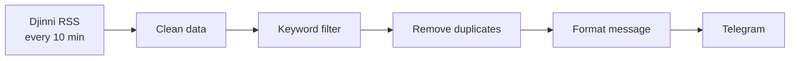

# Djinni Job Alerts — n8n

Get a Telegram message as soon as a matching job appears on [Djinni](https://djinni.co). The workflow checks the Djinni RSS feed every 10 minutes, filters jobs by keywords, removes duplicates and sends a short, readable alert.

It is built for **automation jobs** (n8n, Make, Zapier, AI agents, chatbots), but the keywords are easy to change for any role.


## How it works



1. **RSS Feed Trigger** checks `https://djinni.co/jobs/rss/` every 10 minutes.
2. **Clean data** (JavaScript):
   - takes the job ID from the link (`/jobs/853038-...` → `853038`);
   - turns the HTML description into plain text and keeps lists as `•` bullets;
   - reads the job category and publish date.
3. **Keyword filter** (JavaScript) keeps only relevant jobs (rules below).
4. **Remove Duplicates** uses the job ID, so the same job is never sent twice.
5. **Format message** builds the Telegram message and escapes special characters, so the HTML formatting never breaks.
6. **Send to Telegram** sends the alert.

## Filter rules

All settings are at the top of the `Keyword filter` node:

| Setting | What it does | Default |
|---|---|---|
| `TOOLS` | Searched in the **title and description** | `n8n`, `make.com`, `zapier`, `integromat`, `pipedream` |
| `TITLE_WORDS` | Searched in the **title only** | `automation`, `ai agent`, `chatbot` (+ Ukrainian versions) |
| `EXCLUDE_CATEGORIES` | Categories that are always skipped | QA categories |
| `EXCLUDE_TITLE` | Seniority levels that are skipped | `senior`, `lead`, `head`, `architect`, `director`, `cto`… |
| `EXCLUDE_QA_TITLE` | QA / test roles that are skipped | `qa`, `test automation`, `тестувальник` |
| `TEST_MODE` | `true` sends **all** jobs (for testing) | `false` |

Why are some words searched only in the title? Words like "automation" or "chatbot" often appear in descriptions of unrelated jobs. Tool names like "n8n" are specific enough to search everywhere.

## Example alert

```
🆕 Junior Automation Engineer (n8n)
📂 Other
🔑 n8n, automation

We are looking for a junior engineer to build and support
business automations in n8n…

🔗 Відкрити на Djinni
```

The alert shows the title, category, matched keywords, the first 300 characters of the description and a link to the job.

## Why no AI?

The filter uses simple keyword rules instead of an AI model:

- **Free:** no API costs.
- **Fast:** the alert arrives right after the job is found.
- **Predictable:** the same job always gets the same result, and it is easy to see why a job passed.

The final decision stays with a person: you read the alert and decide whether to apply.

## Tech stack

- **n8n:** RSS Feed Trigger, Code, Remove Duplicates, Telegram
- **JavaScript** for cleaning, filtering and formatting
- **Telegram Bot API**

## Setup

1. Import `djinni-job-alerts.json` into n8n (**Workflows → Import from file**).
2. Create a Telegram bot with [@BotFather](https://t.me/BotFather) and add its token as a Telegram credential in n8n.
3. Send any message to your bot. Then find your chat ID, for example with [@userinfobot](https://t.me/userinfobot).
4. In the `Send to Telegram` node, select the credential and replace `YOUR_CHAT_ID` with your chat ID.
5. In the `Keyword filter` node, change the keywords for the jobs you want.
6. Optional: set `TEST_MODE = true`, run the workflow once and check the messages. Then set it back to `false`.
7. Activate the workflow.

## Limitations

- **Keyword matching only.** It can miss a job that uses different words, or let through a job that only mentions a tool.
- **One Telegram chat.** Alerts go to one chat ID.

## Roadmap

- [ ] Save found jobs to Google Sheets
- [ ] Filters by salary and remote work

---

Built by [Anatolii Tiasko](https://github.com/Anatolii33)
